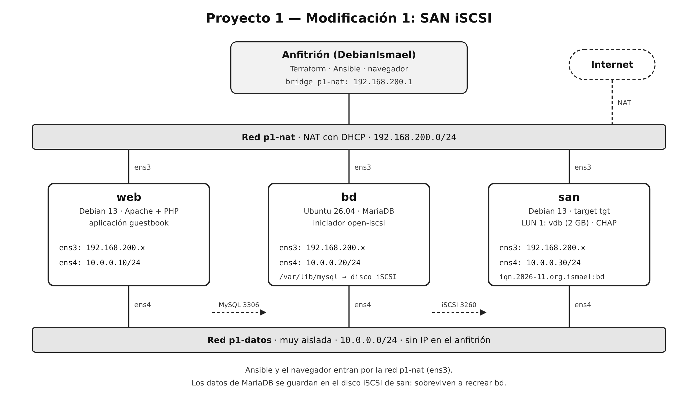

# Proyecto1:  Terraform + Ansible

Escenario con dos máquinas (`web` y `bd`) creado con Terraform sobre libvirt y configurado con Ansible para desplegar una aplicación PHP con MariaDB (guestbook).
Aplicación: https://github.com/josedom24/guestbook_php/tree/main

## Requisitos

- libvirt/KVM con las imágenes `debian13-base.qcow2` y `ubuntu2604_plantilla.img` en el pool `default`
- Terraform (u OpenTofu) y Ansible
- Colección `community.mysql`

## Despliegue

```bash
cd opentofu
terraform init
terraform apply
cd ../ansible
ansible-playbook site.yaml
```

## Modificación 1: SAN iSCSI



- Máquina `san` (Debian 13, 10.0.0.30) con un disco de 2 GB exportado por iSCSI con tgt y autenticación CHAP.
- `bd` se conecta como iniciador (open-iscsi) y monta el disco en `/var/lib/mariadb` con una unidad de systemd por UUID.
- Los datos de MariaDB están en la SAN: sobreviven a recrear `bd`.

## Modificación 2: proxy inverso con HTTPS y CA propia

- Máquina `proxy` (Debian 13, 10.0.0.5), único punto de entrada a la aplicación.
- Ansible crea una autoridad certificadora propia en el equipo de control (`ansible/ca/`, fuera del repositorio) y firma con ella el certificado de `www.ismael.org`.
- El proxy (Apache) recibe por HTTPS, redirige el puerto 80 a HTTPS y reenvía a `web` por la red de datos.
- `web` solo escucha en la red de datos (10.0.0.10).
- Para ver el candado en el navegador, importar `ansible/ca/ca.crt` como autoridad de confianza.
